# Nortonite 64

**Your game library as a 1991 file manager. Built for a TV and a gamepad.**

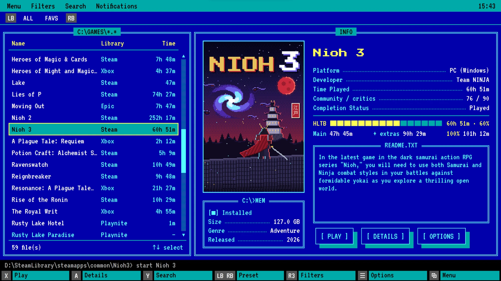

Nortonite 64 is a fullscreen theme for Playnite that takes its look from the two-panel file managers of the DOS era: a blue screen, double-line frames, a cyan menu bar and a blinking command prompt. Under that 1991 surface sits a theme made for the couch. Every screen works with a controller, the focused element is never in doubt, and the text stays readable from across the room.

## Highlights

- **Performance first.** Nortonite 64 weighs about 200 KB of plain XAML, with no DLLs and no background work. It won't slow down your PC, it won't make it stutter and hitch. Playnite themes keep getting bigger. This one goes the other way. The way software was made in the 1990s.
- **Two panels, one glance.** Games on the left like a directory listing. Cover, key facts, progress and description on the right.
- **A command line that follows you.** `D:\Games\Hades> start Hades`, with a blinking block cursor. Start a search and the prompt shows what you type.
- **8 colour palettes**, from classic Norton blue to Synthwave and a dark Arizona desert. Switch them on the fly, every one checked for contrast.
- **Progress at a glance.** A segmented bar driven by HowLongToBeat, with player or critic score as a fallback.
- **One look everywhere.** Menus, filters, settings, on-screen keyboard, dialogs and notifications all match.
- **12 languages, bundled fonts, plain XAML.** No DLLs and nothing extra to install.

## Screenshots

<table>
  <tr>
    <td align="center"><b>Game details</b> 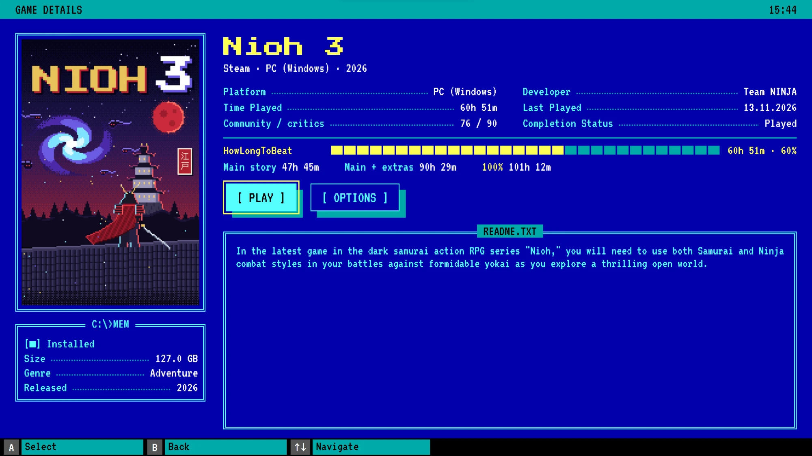</td>
    <td align="center"><b>Game menu</b> 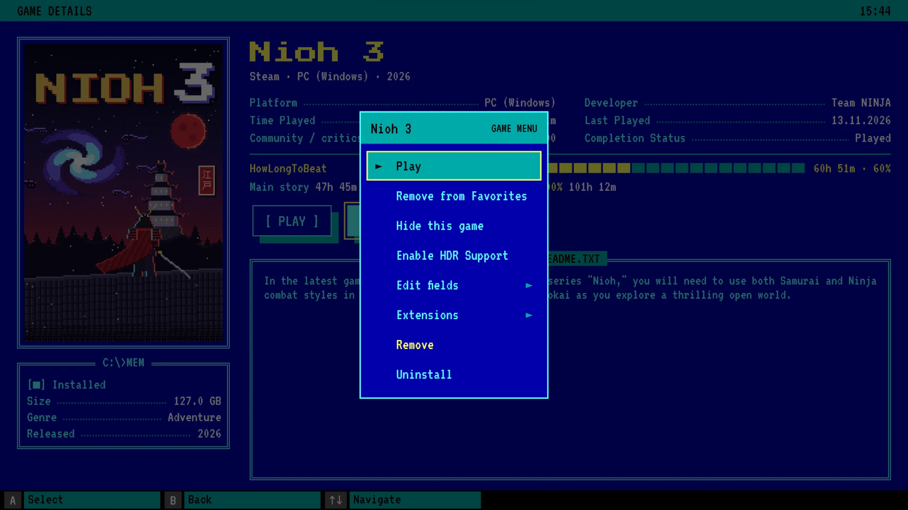</td>
  </tr>
  <tr>
    <td align="center"><b>Theme options</b> 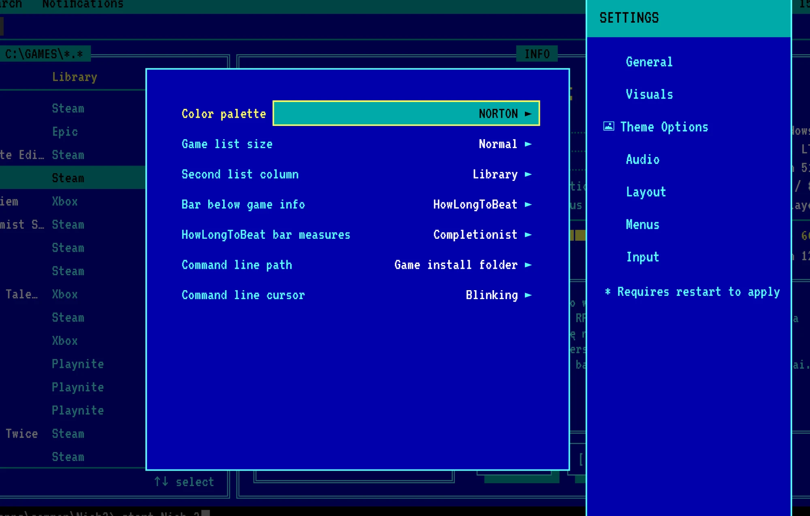</td>
    <td align="center"><b>Notifications</b> 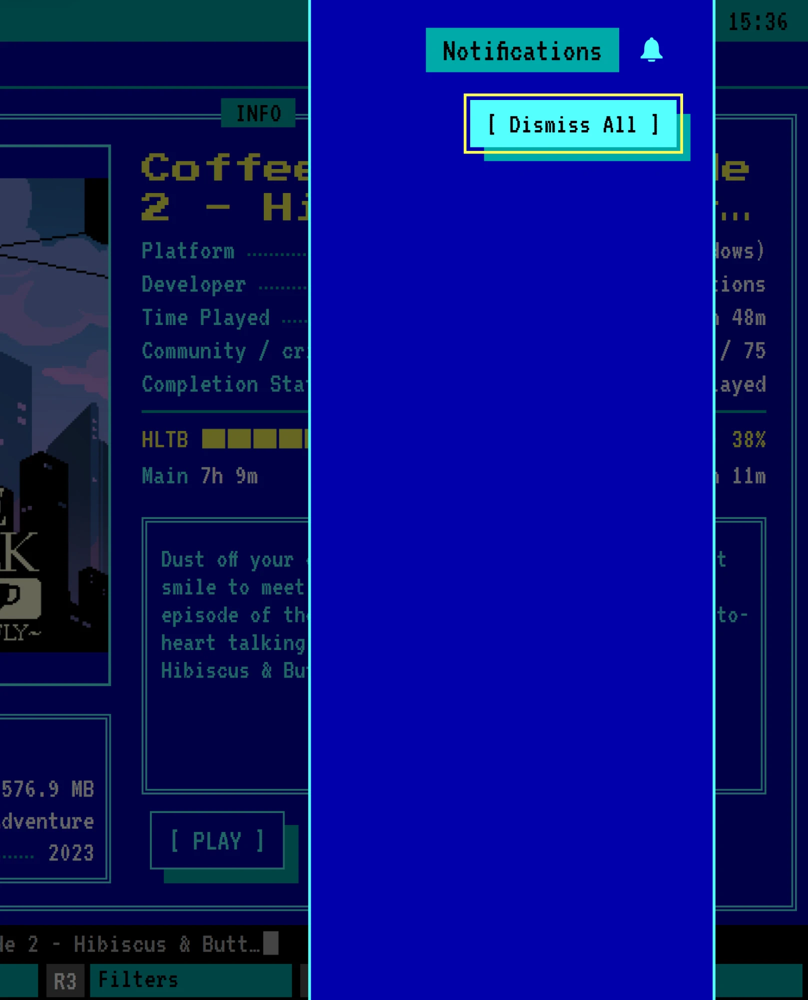</td>
  </tr>
</table>

## Palettes

Pick a palette in the theme options (see [Theme options](#theme-options)). NORTON is the default.

<table>
  <tr>
    <td align="center"><b>NORTON</b> The classic blue file manager </td>
    <td align="center"><b>BIOS</b> Light grey setup utility, the only light palette 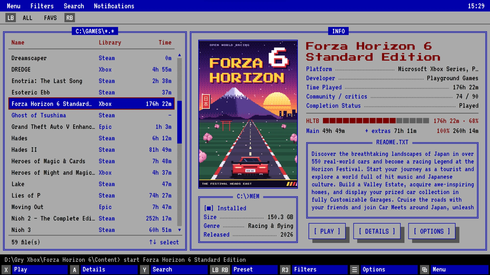</td>
  </tr>
  <tr>
    <td align="center"><b>MS-DOS</b> Plain black screen with grey text, true black for TVs 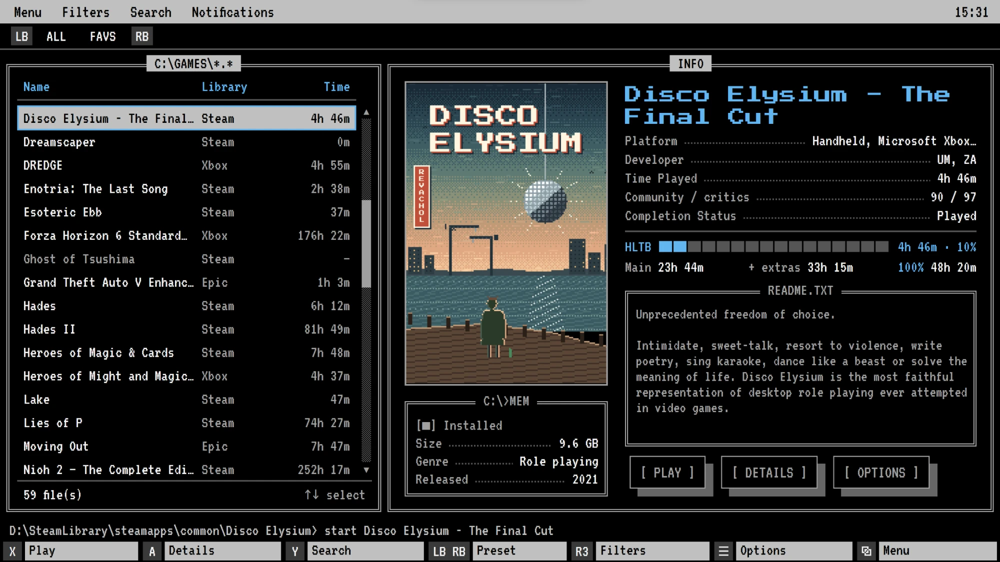</td>
    <td align="center"><b>SYNTHWAVE</b> Deep purple, cyan and hot pink 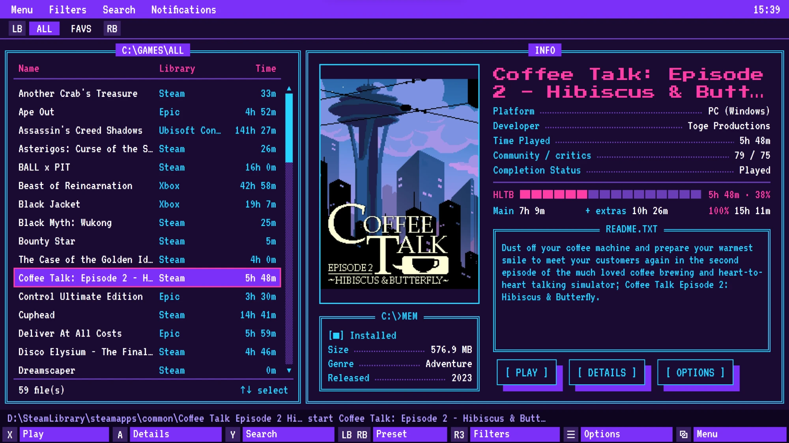</td>
  </tr>
  <tr>
    <td align="center"><b>OUTRUN</b> Night drive in orange, cyan and magenta 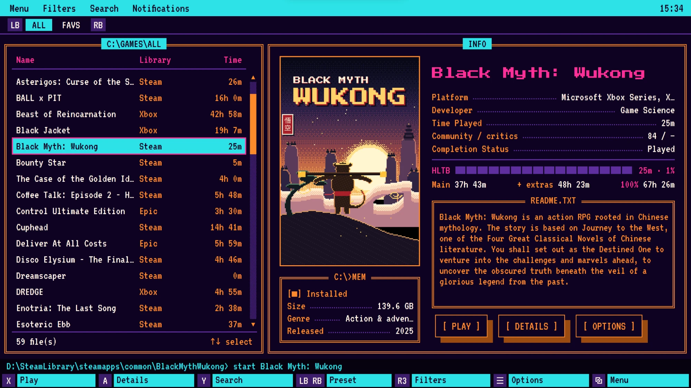</td>
    <td align="center"><b>VAPORWAVE</b> Soft purple with mint and pink 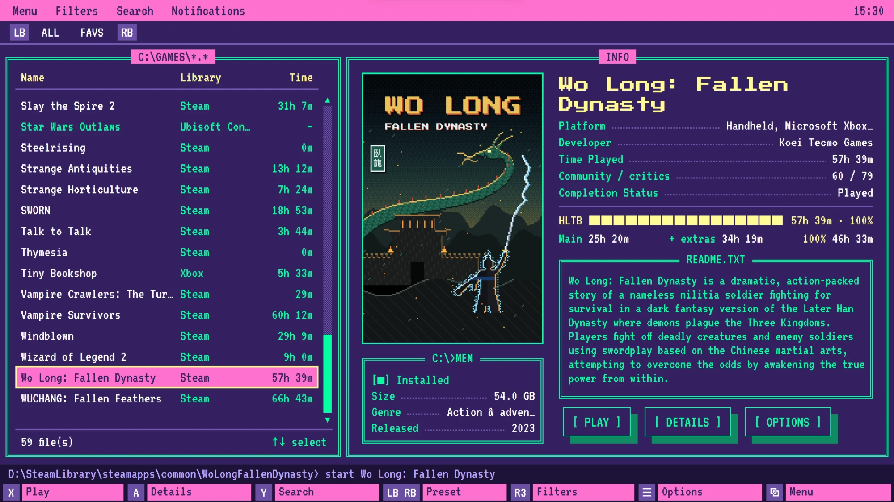</td>
  </tr>
  <tr>
    <td align="center"><b>SUNSET</b> Dark plum with amber and coral 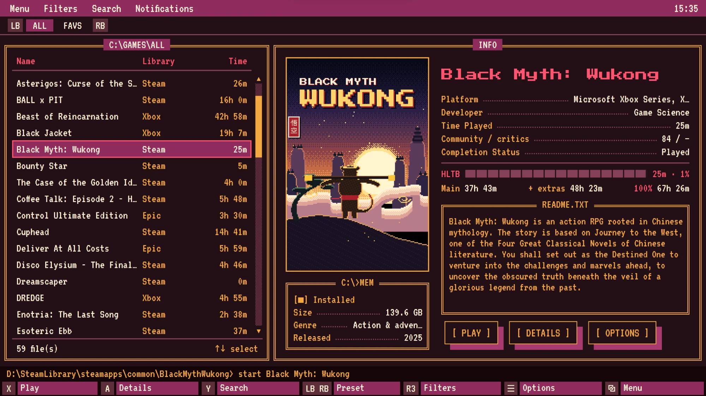</td>
    <td align="center"><b>ARIZONA</b> Desert brown, sand and teal 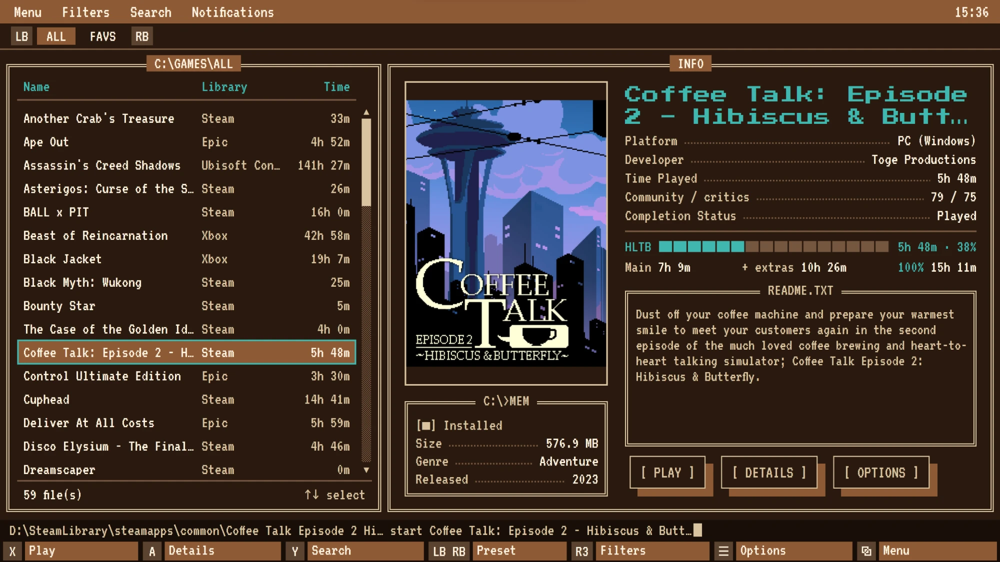</td>
  </tr>
</table>

## Requirements

Playnite 10 (fullscreen theme API 2.10). Developed with Playnite 10.64.

Three optional extensions. Theme Options and HowLongToBeat are in Playnite's official add-on database. Splash Addon Plus installs from the `.pext` file on its Releases page.

| Extension | Author | What it adds | Without it |
|---|---|---|---|
| [Theme Options](https://github.com/ashpynov/ThemeOptions) | Artem Shpynov, Jono | The settings page for palettes and other theme options | The theme runs on its defaults: NORTON palette, HowLongToBeat bar and so on |
| [HowLongToBeat](https://github.com/Lacro59/playnite-howlongtobeat-plugin) | Lacro59 | Completion progress and HLTB times | The bar shows the player or critic score instead, and disappears without a gap when there is no score |
| [Splash Addon Plus](https://github.com/Ad1Bb/Playnite-Splash-Addon-Plus) | Ad1Bb | A loading screen with the game's background and logo, which fades out once the game window appears | The game starts straight from the library, because Nortonite 64 keeps Playnite's own launch screen invisible |

Nortonite 64 never breaks or leaves an empty space when an extension is missing.

## Installation

1. Download the latest `Nortonite64_*.pthm` from [Releases](../../releases).
2. Drag the file onto the Playnite window, or open it with Playnite, and confirm the installation.
3. Choose Nortonite 64 as the fullscreen theme: in fullscreen mode under **Settings → Visuals**, in desktop mode under **Settings → Appearance → Fullscreen**. Restart fullscreen mode if Playnite asks.

To install by hand, extract the `.pthm` file (it is a ZIP archive) into `Themes\Fullscreen\Nortonite64` in your Playnite data folder.

## Recommended setup

Your filter presets appear as tabs under the menu bar, and LB / RB switches between them. For the full file-manager feel, create a few presets in Playnite and mark them as visible in fullscreen mode, for example:

`All` · `Steam` · `GOG` · `Emulators` · `Favorites` · `Recent` · `Completed`

The active preset becomes the folder in the panel title and on the command line, such as `C:\GAMES\STEAM`. With no preset active, the path reads `C:\GAMES\*.*`.

## Theme options

With the Theme Options extension installed, these settings appear next to the active theme. Every change applies immediately, without a restart.

| Option | Choices | Default |
|---|---|---|
| Color palette | NORTON, BIOS, MS-DOS, SYNTHWAVE, OUTRUN, VAPORWAVE, SUNSET, ARIZONA | NORTON |
| Game list size | Compact, Normal, Large (for a TV across the room) | Normal |
| Second list column | Library, Platform, Genre, Developer, Release year, Added, Last played, Time played, Install size, Completion status, Player score, Critic score, Hide | Library |
| Third list column | The same choices as the second column | Time played |
| Bar below game info | HowLongToBeat, Player score, Critic score, Hide | HowLongToBeat |
| HowLongToBeat bar measures | Main story, Main + extras, Completionist | Main story |
| Command line path | Game install folder, Preset path | Game install folder |
| Command line cursor | Blinking, Steady | Blinking |

The game list is yours to arrange. Pick what the second and third columns show, or hide them to give long titles the full width. The column headers follow your choice, and the column widths follow the list size.

<table>
  <tr>
    <td align="center"><b>Second list column</b> 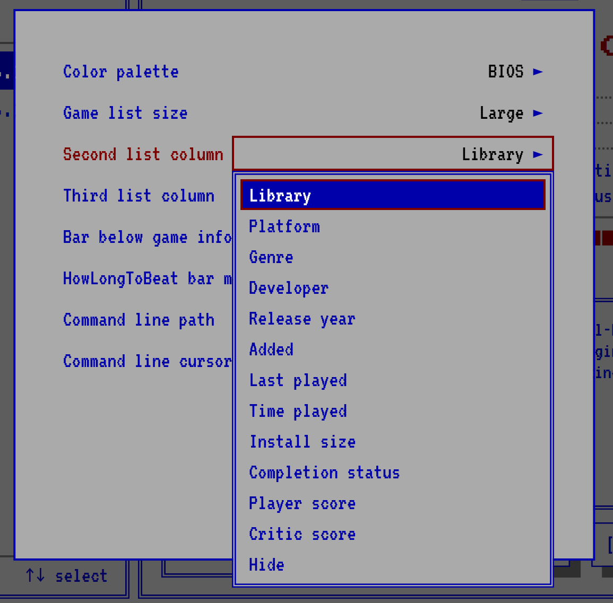</td>
    <td align="center"><b>Third list column</b> 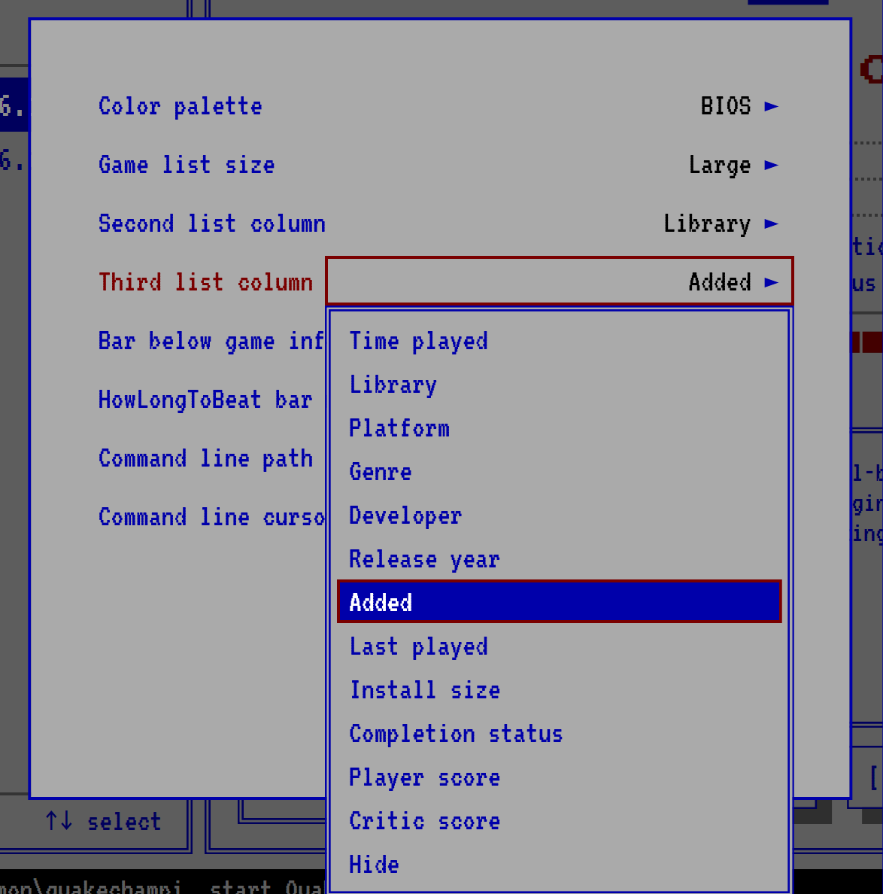</td>
  </tr>
</table>

The bar never shows an empty frame. Without HowLongToBeat data it falls back to the player score, then to the critic score. A chosen score that is missing is replaced by the other one, and with no data at all the bar disappears.

## Languages

English, German, French, Spanish, Italian, Portuguese (Brazil), Polish, Russian, Ukrainian, Czech, Chinese (Simplified) and Japanese.

The theme follows Playnite's interface language and reuses Playnite's own translations wherever they exist. Its own texts, such as `C:\GAMES\`, the pad legend and the panel titles, live in the `Localization` folder. Any other language falls back to English for those texts.

New languages are welcome as pull requests. Copy `Localization/en_US.xaml`, rename it to the Playnite language code (for example `nl_NL.xaml`) and translate the values. Keep button labels short, as the button row fits about 22 Latin characters.

## Known limitations

These come from Playnite itself, not from the theme:

- **Launch screen.** Playnite always shows its game launch screen. Nortonite 64 keeps it invisible, so a game starts straight from your library.
- **Pop-up windows** (menus, settings, message boxes) get a single 3 px frame instead of a double one, because Playnite exposes only a single border for them.

## License

Nortonite 64 by Ad1Bb is released under the [MIT License](LICENSE).

The theme is built on Playnite's default fullscreen theme, © Josef Nemec, also under the MIT License. The bundled fonts keep their own license, the [SIL Open Font License 1.1](https://openfontlicense.org): **VT323** by Peter Hull ([license](Resources/Fonts/OFL-VT323.txt)) and **Press Start 2P** by CodeMan38 ([license](Resources/Fonts/OFL-PressStart2P.txt)).

---

Nortonite 64 is a fan-made theme. It is not affiliated with or endorsed by Playnite, Gen Digital (Norton) or any other company. All product names are trademarks of their owners.
